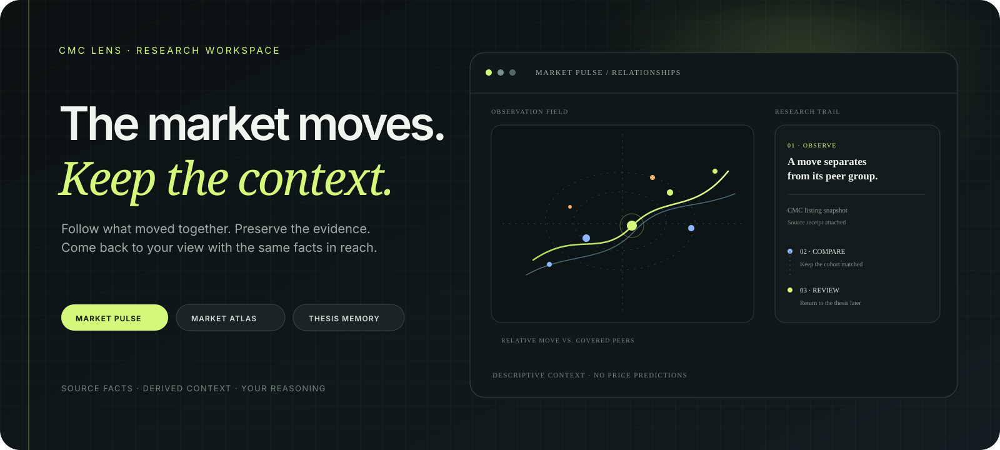

<div align="center">
  
  <h1>CMC Lens</h1>
  <p><strong>Follow the move. Keep the evidence.</strong></p>
  <p>A research workspace for seeing what moved together, recording why it mattered, and revisiting the same evidence later.</p>
  <p>
    <a href="https://cmc-lens.vercel.app"><strong>Open CMC Lens ↗</strong></a>
    &nbsp; · &nbsp;
    <a href="./docs/DEMO_RUNBOOK.md">Watch the demo flow</a>
    &nbsp; · &nbsp;
    <a href="./docs/PRODUCT_BLUEPRINT.md">Product blueprint</a>
  </p>
</div>

<br />

<p align="center">
  
</p>

<p align="center"><sub>A market move is a clue. CMC Lens helps keep its context attached.</sub></p>

---

## What it does

A chart tells you what changed. CMC Lens gives that move its context and gives your research a memory.

- **Market Pulse** brings global market context, breadth, category movement, and sentiment into one view.
- **Market Atlas** maps the top 100 assets by market cap against their covered category peers.
- **RWA Desk** connects tokenized stocks, commodities, and other underlyings to CMC-tracked tokens and issuers, with coverage, volume concentration, and price dispersion context.
- **Explore and Compare** find assets by name, symbol, or CMC ID, then compare a matched cohort.
- **Thesis log** preserves your original view, its evidence, and dated reviews as separate records.
- **Evidence Watch** lets signed-in researchers run manual checks against saved thesis conditions; unsupported or incomplete evidence stays unknown.
- **Source receipts** show which CMC endpoints were called, their outcome, cache state, timestamps, and safe response summaries.

CMC Lens keeps provider observations, derived calculations, and your own reasoning distinct. It is a research tool, not a trading signal or investment advice.

## Designed for careful research

The visual system is built around a simple idea: **the market is a field of relationships, not a row of isolated prices.** Dark and light themes share the same hierarchy, chart meaning, and interaction states. Motion is restrained and tied to data loading or selection.

## Data and attribution

CMC data is requested on the server. The CMC Pro API key never reaches browser code. The live app includes visible CoinMarketCap attribution in market-data views.

The Atlas is a top-100 market-cap sample. Category peer means are descriptive and equal-weighted; missing quotes and thin peer groups stay missing instead of being filled with guesses. Historical replay depends on CMC plan access and the shared request budget.

The RWA Desk uses CMC's `/v5/real-world-assets/` endpoints. Evidence Watch supports crypto quote checks and RWA token-price coverage, price range, and attributed issuer-volume share. Checks are user-triggered and do not change thesis status or make trading decisions.

## Run locally

Prerequisites: Node.js and the Vercel CLI.

```bash
git clone https://github.com/NomadDigita/CMC-Lens.git
cd CMC-Lens
cp .env.example .env.local
```

Add the server-side `CMC_PRO_API_KEY` when you need live CMC data. Add the Supabase URL and publishable key for private account sync. Email-code sign-in works when Supabase Auth is configured; Google sign-in also requires the Google provider and redirect URLs to be configured in Supabase.

```bash
npx vercel dev
```

Never commit `.env.local`, put provider secrets in browser code, or include tokens in screenshots.

## Build, data, and release notes

- [Product blueprint](./docs/PRODUCT_BLUEPRINT.md)
- [UI/UX redesign plan](./docs/UI_UX_REDESIGN.md)
- [CMC API data plan](./docs/API_DATA_PLAN.md)
- [Hackathon readiness](./docs/CMC_HACKATHON_READINESS.md)
- [Demo runbook](./docs/DEMO_RUNBOOK.md)

The public app may show clearly labeled demo values when API configuration is absent. Live API coverage and source status are time-sensitive and visible in the app.

<div align="center">
  <br />
  <strong>See what moved together. Keep what you learned.</strong>
  <br /><br />
  <a href="https://cmc-lens.vercel.app">CMC Lens ↗</a>
</div>
